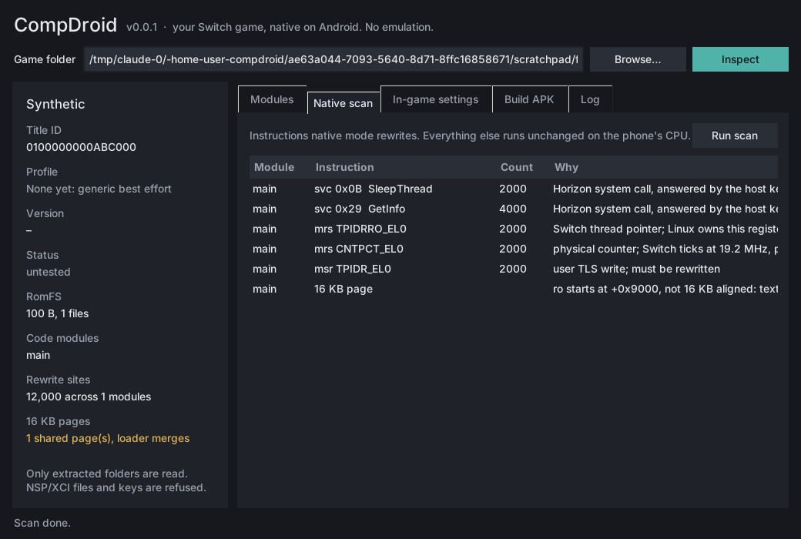
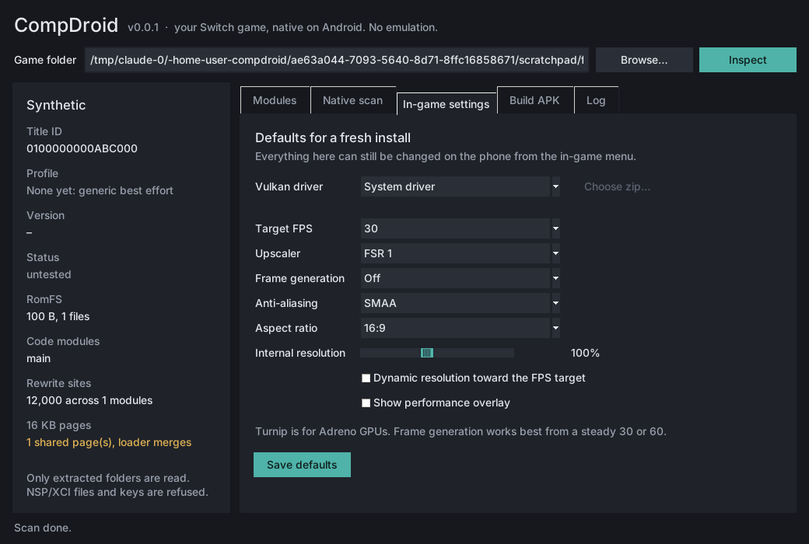

# CompDroid

A Windows tool that turns a Nintendo Switch game **you own** into a native Android app.
It is **not an emulator**: the game's own AArch64 code runs directly on the phone's CPU
(both are ARM64), the few instructions that talk to the Switch kernel are rewritten,
system services are answered by a small host runtime, and the NVN graphics API is
translated to Vulkan. The in-game menu offers a Vulkan driver picker (e.g. Mesa Turnip),
a target FPS, internal resolution, FSR 1 / Snapdragon GSR upscaling and frame generation.

The design follows the native-execution ports (d2r-mobile, MacNativeGames, BOTWRecompAndroid's
Native Mode) and starts from the LAS Recomp / LASRecompAndroid engine (MIT).
Full research and plan: [docs/ARCHITECTURE.md](docs/ARCHITECTURE.md).

> **No game files, keys or firmware are included or downloaded.** CompDroid only reads an
> already-extracted `exefs/` + `romfs/` folder from your own copy. It does not open NSP/XCI
> files, read `prod.keys`, or decrypt anything. APKs it builds contain your game's code: keep
> them on your own devices.

## Status

| Milestone | What | State |
| --- | --- | --- |
| M0 | Builder CLI + desktop window: dump inspector, native-mode scanner, in-game defaults, profiles | done |
| M1 | Runtime template APK, inject, sign, adb install + romfs push | next |
| M2 | First game boots natively (Link's Awakening) | |
| M3 | In-game settings overlay (driver, FPS, resolution, upscaling, frame gen) | |
| M4 | Second game from a profile (BOTW), then the Windows GUI | |

## Builder quick start (Windows)

Requires Python 3.11+ from python.org or `winget install Python.Python.3.12` (Tkinter is included).

```powershell
py -m pip install -e builder
compdroid-gui                            # the desktop window
compdroid inspect D:\dumps\MyGame      # or the CLI: folder holding exefs\ and romfs\
compdroid scan    D:\dumps\MyGame      # what native mode must rewrite
```



The window loads a dump, shows the game card (title ID, profile, version, RomFS, rewrite sites),
the code modules, the native scan, and the **in-game settings** a fresh install starts with:
Vulkan driver (system or a Turnip zip), target FPS, internal resolution, upscaler (FSR 1 /
Snapdragon GSR 1), frame generation, anti-aliasing and aspect ratio. Defaults are saved per game to
`%USERPROFILE%\CompDroid\out\<title id>\default_settings.json`. The Build APK tab is laid out and
switches on with M1.



`inspect` prints the title ID, each module's build ID, the RomFS size and whether a profile
in `profiles/` matches. `scan` lists every `svc` (by Horizon system call), every TLS and
counter register access, and any segment that is not 16 KB aligned (newer phones use 16 KB
pages). Add `--json` to either for machine-readable output.

## Layout

```
builder/    Python builder (CLI now, GUI later), tests use synthetic fixtures only
profiles/   per-game facts and patches, one folder per title ID (see profiles/SCHEMA.md)
runtime/    C++ native runtime: loader, HLE kernel/services, NVN->Vulkan (M1+)
android/    Android app shell and template APK (M1+)
docs/       architecture and research notes
```

## Tests

```bash
cd builder && python -m pip install -e .[test] && python -m pytest
```
